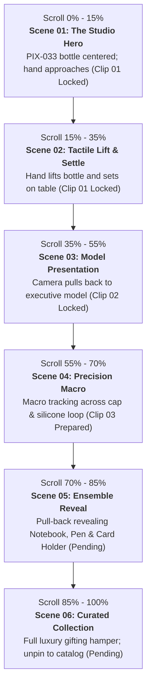

# Creative Discovery & Production Brief: Scroll-Controlled Cinematic Homepage
**Client / Brand:** AV Corporate Giftings & Events  
**Document Type:** Creative Discovery, Storyboard Architecture & Google Veo Video Generation Blueprint  
**Date:** October 2026  
**Status:** CREATIVE DISCOVERY & PLANNING ONLY (Pre-Generation Gate)

---

## Executive Overview

This creative production brief defines the complete concept, product selections, scene-by-scene storyboard, AI video generation prompts, and frame-extraction engineering plan for the scroll-controlled homepage experience of **AV Corporate Giftings & Events**.

Inspired by Apple-style keynote product films and editorial corporate gifting aesthetics, this experience replaces static e-commerce banners with a **scroll-synchronized cinematic narrative**. As the visitor scrolls down the page, a hero corporate gift transforms from an intimate handheld presentation into a tactile macro study of materials, introduces executive companion gifts, and culminates in a curated gifting collection.

---

## 1. Catalog & Asset Audit

### 1.1 Source Catalog Inventory
- **Master Catalog Source:** `PIX-CATALOG 24-25 - 2.pdf` (60 pages, 159 master catalog entries, 9 product categories).
- **Extracted Asset Binaries:** 339 unique image binaries, 335 verified product photographs across `public/catalog-assets/raw/` and contact sheets in `public/catalog-assets/contact-sheets/`.
- **Reference Hero Visual:** `Thoughtfully Made Corporate Gifts.png` (stored at `public/images/pix-hero-banner.png`).

### 1.2 Critical Brand Identity Finding: AV vs. Supplier (PIX)
> [!IMPORTANT]
> **Essential Brand Clarification:**
> - The live website brand is **AV Corporate Giftings & Events** (referred to as **AV**).
> - The physical source catalog and extracted manufacturer photographs originate from the manufacturing supplier **Plastico Impex (PIX)**.
> - The reference mockup (`Thoughtfully Made Corporate Gifts.png`) explicitly displays **"PIX PLASTICO IMPEX"** imprinted onto the bottle, notebook, desk tumbler, card holder, pen stand, and keychain.
> - **Mandatory Creative Gate:** The AI video generation process **must never reproduce the letters "PIX" or "PLASTICO IMPEX"**. All video generations must either feature **clean, unbranded minimalist surfaces** or incorporate subtle, bespoke **"AV" / "AV Corporate"** laser engravings.

### 1.3 Audit of Real Products vs. Supplier Logos in Existing Assets
| Asset Category | Catalog Evidence | Brand Status | Suitability for Veo Reference |
| :--- | :--- | :--- | :--- |
| **`PIX-033` (500ml Thermos Bottle)** | `public/products/pix-033-hero.jpeg`<br>`asset_p03_xref220_931bf270.jpeg` | **Completely Unbranded** | **Ideal Primary Reference.** Clean matte finish, no supplier logos, exact silhouette as reference mockup. |
| **`PIX-NB-102` (Hardbound Notebook)** | `public/products/pix-nb-102-hero.jpeg`<br>`asset_p31_xref1350_619608d8.jpeg` | **Completely Unbranded** | **Ideal Supporting Reference.** Blank dark PU leather cover, magnetic metal clasp plate ready for AV debossing. |
| **`PIX-PN-1003` (Executive Metal Pen)** | `public/products/pix-pn-1003-hero.jpeg`<br>`asset_p41_xref1860_b77dd2f5.jpeg` | **Completely Unbranded** | **Ideal Supporting Reference.** Weighted metal barrel, chrome trim, no visible supplier markings. |
| **`PIX-5002` (Thermal Desk Mug)** | `public/products/pix-5002-hero.jpeg`<br>`asset_p18_xref905_bd38d08f.jpeg` | **Completely Unbranded** | **Ideal Supporting Reference.** Dual-material cork base and stainless body without logos. |
| **`PIX-CH-1001` (PU & Metal Card Holder)** | `public/products/pix-ch-1001-hero.jpeg`<br>`asset_p50_xref2456_43dfa56e.jpeg` | **Completely Unbranded** | **Ideal Supporting Reference.** Clean brushed steel and green PU flap without logos. |
| **`PIX-BMB-03` (Bamboo Tumbler/Clock)** | `public/products/pix-bmb-03-hero.jpeg`<br>`asset_p53_xref2536_579117ba.jpeg` | **Completely Unbranded** | **Ideal Supporting Reference.** Natural organic bamboo grain, no supplier branding. |
| **`PIX-KC-1001` (Round Medallion Keyring)** | `public/products/pix-kc-1001-hero.jpeg`<br>`asset_p47_xref2307_7ca6aa24.jpeg` | **Completely Unbranded** | **Ideal Supporting Reference.** Clean circular zinc alloy plate. |
| **Catalog Human Model Shots** | `asset_p06_xref361_a26e69a0.jpeg`<br>`asset_p07_xref407_c1c981fe.jpeg`<br>`asset_p08_xref450_433542b2.jpeg`<br>`asset_p08_xref453_e4547333.jpeg` | **Hand & Loop Detail Shots** | **High Utility.** Demonstrates real human hand grip, loop lifting, and cap opening under neutral lighting. |
| **Catalog Watermarked Assets** | `asset_p19_xref95..` ("JWT" logo)<br>`asset_p23_xref11..` ("YOUR LOGO") | **Watermarked / Generic** | **Excluded from Generation Prompts.** Must not be used as conditioning inputs to prevent artifact propagation. |
| **Reference Hero Banner** | `public/images/pix-hero-banner.png` | **Contains "PIX" Everywhere** | **Composition & Lighting Reference ONLY.** Must be flagged with negative prompt against "PIX" text. |

---

## 2. Product Selection & Hero Shortlist

### 2.1 Primary Hero Product: `PIX-033` Thermos Vacuum Bottle (500ml)
- **Catalog Name:** THERMOS BOTTLES PIX-033
- **SKU:** `PIX-033` (Source Page 4)
- **Category:** Thermos Bottles
- **Source Asset:** `public/products/pix-033-hero.jpeg` (Binary: `asset_p03_xref220_931bf270.jpeg`)
- **Material & Build:** Food-grade SUS 304 double-wall vacuum stainless steel; 12-hour thermal retention.
- **Physical Specifications:** 500ml capacity, cylindrical silhouette with taper-free body, silicone neck collar, screw-cap with integrated pivoting carrying ring/loop handle.
- **Color & Finish:** Matte sage/forest green powder-coated exterior with brushed stainless steel lid top.
- **Why It Leads:** 
  1. It is the **exact hero bottle** presented in the user's reference mockup.
  2. The catalog asset is 100% unbranded and high contrast.
  3. The silicone carrying loop and metal collar provide dynamic tactile interaction (lifting, tilting, finger carry) for human-model transitions.
  4. The cylindrical shape creates continuous specular highlights during camera rotation.

### 2.2 Supporting Product Ensemble (Curated Corporate Collection)
The supporting products were chosen to form a complete **Executive Welcome & Client Appreciation Suite**:

1. **`PIX-NB-102` — Executive Hardbound Thermal PU Notebook (208 Pages)**
   - *Category:* Notebooks (Page 31) | *Asset:* `public/products/pix-nb-102-hero.jpeg`
   - *Materials:* Deep forest green thermal PU cover, matching elastic closure band, satin ribbon bookmark, 80 GSM acid-free cream paper, brushed metal clasp plate.
   - *Role:* Grounding stationery anchor in Scene 04 and 05.
2. **`PIX-PN-1003` — Heavy-Weight Executive Metal Rollerball Pen**
   - *Category:* Pens (Page 41) | *Asset:* `public/products/pix-pn-1003-hero.jpeg`
   - *Materials:* Solid brass core, dark green lacquer finish, electroplated chrome trim, spring-tension clip, German-standard tungsten roller tip.
   - *Role:* Precision metallic companion resting alongside the notebook in Scene 04.
3. **`PIX-5002` — Thermal Desk Mug with Natural Cork Base (450ml)**
   - *Category:* Thermos Mugs (Page 18) | *Asset:* `public/products/pix-5002-hero.jpeg`
   - *Materials:* SUS 304 stainless steel body, warm cream powder coat, natural acoustic cork base, sliding splash-proof lid.
   - *Role:* Modern desk utility piece providing warm organic texture in Scene 05.
4. **`PIX-CH-1001` — Executive PU & Brushed Metal Visiting Card Holder**
   - *Category:* Card Holders (Page 50) | *Asset:* `public/products/pix-ch-1001-hero.jpeg`
   - *Materials:* Precision-machined brushed stainless steel chassis with wave-cut forest green PU magnetic closure flap.
   - *Role:* Pocket accessory accentuating metallic craftsmanship in Scene 04.
5. **`PIX-BMB-03` — Natural Bamboo Multi-Pen Tumbler with Analog Clock**
   - *Category:* Bamboo Desk Utility (Page 53) | *Asset:* `public/products/pix-bmb-03-hero.jpeg`
   - *Materials:* 100% sustainably harvested organic bamboo, twin pen holding wells, precision quartz analog clock insert.
   - *Role:* Natural wooden element matching the bamboo pen cup in the reference flat lay.
6. **`PIX-KC-1001` — Zinc Alloy & Leatherette Round Medallion Keyring**
   - *Category:* Metal Keychains (Page 47) | *Asset:* `public/products/pix-kc-1001-hero.jpeg`
   - *Materials:* Heavy polished zinc alloy circular medallion with stitched forest green leatherette strap.
   - *Role:* Delicate finishing detail in the final gift tray composition (Scene 05).

---

## 3. The Complete Scroll Story & Storyboard

The scroll experience is mapped across a **450vh sticky pinned container** where scroll position directly controls frame playback.



### Detailed Scene-by-Scene Storyboard

#### Scene 01: The Studio Hero & Hand Approach (Canonical Clip 01 - Locked)
- **Scroll Range:** `0%` to `15%` of pinned scroll distance (0vh – 65vh).
- **Video Source:** Canonical Clip 01 (`Hand_lifting_thermos_bottle_1080p_20261020004431.mp4`), Frames 001–108 (t=0.0s – 4.5s).
- **Purpose:** Establish the tactile luxury and premium minimalism of AV Corporate Giftings through an unbranded, centered hero reveal.
- **Primary Product:** `PIX-033` (500ml Thermos Bottle, Matte Sage Green, 100% unbranded).
- **Visual State:** The bottle stands poised near the center of the frame on a warm ivory plaster surface (`#F4F5EB`), with soft diffused morning daylight from 45° upper-left. At t=2.5s, an elegant hand wearing a tailored dark forest-green wool suit cuff and white shirt cuff enters smoothly from the right and wraps naturally around the bottle cylinder.
- **Compositional Lock:** Center-framed bottle (not artificially right-aligned). Native 16:9 composition preserved with existing Veo watermark accepted.
- **Camera Movement:** Slow, subtle motorized push-in (85mm prime, f/2.0).

#### Scene 02: The Tactile Lift & Settling Hold (Canonical Clip 01 - Locked)
- **Scroll Range:** `15%` to `35%` of pinned scroll distance (65vh – 150vh).
- **Video Source:** Canonical Clip 01, Frames 109–240 (t=4.5s – 10.0s).
- **Purpose:** Demonstrate ergonomic handling, balanced physical weight, and tactile finish as the hand lifts the bottle ~3-4 inches, tilts it gently, and lowers it back to the table into a rock-steady stationary hold.
- **Visual State:** Hand lifts the bottle, rotates it 15 degrees catching delicate specular highlights across the brushed stainless steel cap, then smoothly lowers it back onto the ivory plaster surface. From Frame 216 to 240 (t=9.0s–10.0s), the hand and bottle settle into a stationary, rock-steady hero hold at center-frame.
- **Visual Bridge:** Frame 236/240 (`public/hero-frames/clip-02-reference-start.png`) serves as the verified starting frame for Clip 02.

#### Scene 03: The Corporate Model Presentation (Canonical Clip 02 - Locked)
- **Scroll Range:** `35%` to `55%` of pinned scroll distance (150vh – 235vh).
- **Video Source:** Canonical Clip 02 (`Executive_presenting_sage_green_…_20261020012128.mp4`), Frames 001–240 (10.0s).
- **Purpose:** Humanize corporate gifting through an organic, physically plausible camera pull-back that reveals the hand belonging to an executive corporate model presenting the bottle with both hands.
- **Starting Visual State:** Begins exactly on Frame 236/240 of Clip 01 (close-up on centered bottle held by hand in forest-green sleeve).
- **Ending Visual State:** The camera smoothly dollies out to a medium close-up (waist-to-chest). The forest-green sleeve connects to a tailored dark forest-green wool blazer over a warm ivory shirt. The model brings their second hand into frame, cradling the bottle with two hands in a gracious gifting presentation. The model's face remains softly de-emphasized in the upper third (out of focus above collar), keeping the unbranded bottle and hands as the sharp, primary hero.
- **Camera Movement:** Smooth motorized dolly-out pull-back and subtle pedestal rise (85mm prime, f/2.0).
- **Visual Bridge:** Frame 235 (`public/hero-frames/clip-03-reference-start.png`) serves as the verified bridge to Scene 04.

#### Scene 04: Precision Macro Product Showcase (Canonical Clip 03 - Locked)
- **Scroll Range:** `55%` to `72%` of pinned scroll distance (275vh – 360vh).
- **Video Source:** Canonical Clip 03 (`Thermos_bottle_close-up_showcase_1080p_20261020014019.mp4`), Frames 001–240 (10.0s).
- **Purpose:** Showcase certified SUS 304 food-grade stainless steel integrity, circular brushed cap grain, black silicone collar with pivoting loop, and tactile matte powder-coat.
- **Primary Product:** `PIX-033` (500ml Thermos Vacuum Bottle).
- **Visual State:** Editorial match-cut from the model's hold directly into an extreme macro close-up. Camera glides horizontally left-to-right across the brushed stainless steel cap, black silicone collar with pivoting loop hinge, and down the curved shoulder of the matte sage-green powder-coated cylinder.
- **Camera Movement:** Micro slider tracking shot left-to-right (100mm Macro, f/2.8).
- **Lighting & Mood:** Directional micro-rim lighting highlighting metal grain and soft diffuse matte green finish against warm ivory background (`#F4F5EB`).
- **Key Consistency Constraint:** Closed cap only, no internal cutaways, completely unbranded with zero logos or text.
- **Visual Bridge:** Frame 235 (`public/hero-frames/clip-04-reference-start.png`) serves as the verified bridge to Scene 05.

#### Scene 05: The Ensemble Reveal (Canonical Clip 04 - Locked)
- **Scroll Range:** `72%` to `88%` of pinned scroll distance (360vh – 440vh).
- **Video Source:** Canonical Clip 04 (`Camera_filming_corporate_gift_set_20261020015325.mp4`), Frames 001–240 (10.0s).
- **Purpose:** Expand the story from a single drinkware item to a curated corporate gifting suite on a honed travertine tray.
- **Products Introduced:** `PIX-033` (Bottle), `PIX-NB-102` (Notebook), `PIX-PN-1003` (Pen), `PIX-CH-1001` (Card Holder).
- **Starting Visual State:** Begins from the macro bottle composition (Frame 235 of Clip 03), executing a smooth motorized pull-back and gentle rise.
- **Ending Visual State:** The full upright thermos bottle stands at the right flank; the dark forest-green PU notebook (`PIX-NB-102`) rests flat on the light travertine stone tray in the center; the dark green and chrome metal pen (`PIX-PN-1003`) aligns neatly along the notebook; the brushed-metal card holder (`PIX-CH-1001`) sits as a refined metallic accent in the foreground.
- **Camera Movement:** Motorized pull-back and pedestal rise to 35°–45° high-angle tabletop view (50mm prime, f/2.8).
- **Lighting & Mood:** Soft overhead morning daylight with natural contact shadows on the warm ivory plaster / travertine surface.
- **Key Consistency Constraint:** Realistic object scaling (bottle 26cm, notebook 21cm, pen 14cm, card holder 9.5cm). 100% clean surfaces with zero physical branding.
- **Visual Bridge:** Frame 236 (`public/hero-frames/clip-05-reference-start.png`) serves as the verified bridge to Scene 06.

#### Scene 06: Curated Gift Tray & Final Statement (Canonical Clip 05 - Locked)
- **Scroll Range:** `88%` to `100%` of pinned scroll distance (440vh – 600vh).
- **Video Source:** Canonical Clip 05 (`Corporate_gift_collection_display_1080p_20261020021656.mp4`), Frames 001–240 (10.0s).
- **Purpose:** Deliver the editorial "WOW" shot showcasing the complete 7-product corporate gifting collection, then smoothly unpin into catalog browsing.
- **Products Featured:** Complete 7-product master collection (`PIX-033` Bottle, `PIX-NB-102` Notebook, `PIX-PN-1003` Pen, `PIX-5002` Desk Mug with Cork Base, `PIX-CH-1001` Card Holder, `PIX-BMB-03` Bamboo Stand, `PIX-KC-1001` Round Keyring).
- **Starting Visual State:** Respects the tabletop composition of Clip 04 (Frame 236).
- **Ending Visual State:** The complete curated corporate collection is showcased: bamboo pen tumbler and acoustic dock on the left, cream/cork desk mug on mid-left, pristine dark-green notebook and card holder in center, metal pen adjacent, round medallion keyring in the front foreground, and the hero bottle upright on the right. Soft botanical eucalyptus foliage deeply blurred in background. Camera stabilizes into a rock-steady hold; sticky canvas wrapper smoothly transitions into standard catalog document flow.
- **Lighting & Mood:** Lush editorial morning lighting, warm cream ambiance (`#F4F5EB`), generous and bespoke.
- **Key Consistency Constraint:** Zero PIX or Plastico Impex text; zero notebook lettering; pristine editorial balance.
- **Final Terminal Frame:** Frame 236 (`public/hero-frames/clip-05-final-frame.png`).

---

## 4. Typography & Copy Architecture (Separated Web UI Overlays)

> [!NOTE]
> All typography, headlines, and call-to-action buttons will be rendered as **live HTML/CSS layers positioned over the frame canvas**, never baked into video pixels. This guarantees sub-pixel vector clarity, instant translation, dynamic accessibility, and zero text morphing artifacts.

### Copy Mapping Across Scroll Beats

| Scroll Range | Scene Name | Headline Overlay (HTML) | Subtitle / Caption (HTML) | CTA Button (HTML) | Entry / Exit Animation |
| :---: | :---: | :---: | :---: | :---: | :---: |
| **0% – 25%** | Scene 01 & 02 | **GIFTS THAT<br>MAKE AN IMPACT** | Bespoke corporate gifts for clients, teams & executive events. | `[ Explore Catalog ]`<br>`[ Request a Quote ]` | **Entry:** Fade in + translateY(0) at 0%.<br>**Exit:** Subtle fade to opacity 0.2 at 25% to emphasize product detail. |
| **25% – 50%** | Scene 03 | **CRAFTED TO ENDURE** | Food-grade SUS 304 steel. Double-wall thermal vacuum insulation. | — | **Entry:** Smooth blur-in from 26%.<br>**Exit:** Cross-dissolve out at 48%. |
| **50% – 75%** | Scene 04 | **CURATED FOR TEAMS** | Hardbound executive diaries, precision pens & tailored deskware. | `[ Build a Custom Kit → ]` | **Entry:** Slide up 15px with fade at 52%.<br>**Exit:** Fade at 74%. |
| **75% – 100%** | Scene 05 & 06 | **GIFTS THAT<br>MAKE AN IMPACT** | Complete bespoke hampers for onboarding, milestones & clients. | `[ Launch Kit Builder → ]`<br>`[ Review RFQ Basket ]` | **Entry:** Restores primary headline with full opacity at 76%.<br>**Hold:** Remains pinned until scroll unpins. |

---

## 5. Google Veo Video Generation Strategy

### 5.1 Evaluation of Generation Methodologies

| Approach | Description | Pros | Cons | Verdict |
| :--- | :--- | :--- | :--- | :--- |
| **Approach A: Single Continuous Video** | One long prompt generating 15–20s in one continuous camera move. | Continuous motion; no manual stitching required. | High probability of product shape drift, lid morphing, melting hands, and severe loss of product identity. | **REJECTED.** |
| **Approach B: Multi-Clip Stitching** | 4 to 5 short clips (3–4s each) generated with strict start/end keyframe conditioning. | High control over individual scene lighting, isolated regenerations, predictable camera paths. | Requires meticulous first-frame/last-frame image conditioning to prevent jump cuts. | **ACCEPTED FOR DYNAMIC CLIPS.** |
| **Approach C: Hybrid Video + 2.5D Parallax** | AI video generated for dynamic hand interactions (Scene 02); high-res catalog photographs used with 2.5D camera projection for macro (Scene 03) and collection (Scene 05). | 100% photographic fidelity for real catalog products; zero hallucinations of SKU details. | Requires compositing camera projection layers in After Effects or code. | **HIGHLY RECOMMENDED BACKUP.** |

### Recommended Production Protocol: Modular 5-Clip Sequence (ALL 5 CLIPS APPROVED & LOCKED)
The 5 canonical clips have all been generated in Google Veo, inspected, mirrored to the workspace, pre-sliced into 240 WebP frames each, and permanently locked:
- **Canonical Clip 01 (Scenes 01–02) [APPROVED & LOCKED]:** `Hand_lifting_thermos_bottle_1080p_20261020004431.mp4` (10.0s, 240 frames). Bottle centered, hand enters from right, lifts and returns bottle to table into a stationary hold.
- **Canonical Clip 02 (Scene 03) [APPROVED & LOCKED]:** `Executive_presenting_sage_green_…_20261020012128.mp4` (10.0s, 240 frames). Camera pulls back to reveal executive model in dark forest-green blazer holding bottle with two hands.
- **Canonical Clip 03 (Scene 04) [APPROVED & LOCKED]:** `Thermos_bottle_close-up_showcase_1080p_20261020014019.mp4` (10.0s, 240 frames). Precision macro product showcase across brushed stainless steel cap, black silicone collar with pivoting loop, and textured matte sage-green body.
- **Canonical Clip 04 (Scene 05) [APPROVED & LOCKED]:** `Camera_filming_corporate_gift_set_20261020015325.mp4` (10.0s, 240 frames). Tabletop pull-back and ensemble reveal of bottle, notebook, pen, and card holder on travertine tray / ivory surface.
- **Canonical Clip 05 (Scene 06) [APPROVED & LOCKED]:** `Corporate_gift_collection_display_1080p_20261020021656.mp4` (10.0s, 240 frames). Master corporate gift collection on travertine tray (7 verified products), settling into rock-steady commercial hold and page handoff.

### 5.2 Product Continuity Checklist
Before any clip is approved for frame extraction, it must pass this 8-point gate:
1. [ ] **Silhouette Integrity:** `PIX-033` maintains identical neck taper, shoulder diameter, and base proportions.
2. [ ] **Lid & Collar Architecture:** Brushed steel cap with cylindrical black silicone collar and pivoting loop remains consistent.
3. [ ] **Color Calibration:** Powder-coat maintains exact `#4A6B53` (muted sage/forest green) across all camera angles; no shifting to teal or lime.
4. [ ] **Surface Finish:** Matte finish remains non-reflective; stainless steel accents retain directional brushed texture.
5. [ ] **Human Anatomy:** Exactly five fingers per hand, natural cuticle lines, realistic joint bends, zero morphing skin.
6. [ ] **Scale Proportion:** Notebook is A5 scale relative to 500ml bottle; pen barrel is standard 138mm length.
7. [ ] **Zero Brand Hallucination:** No "PIX", "Plastico Impex", "JWT", or illegible glyphs appear anywhere on products.
8. [ ] **Lighting Direction:** Key light consistently originates from upper-left (approx. 45 degrees elevation, 30 degrees azimuth).

---

## 6. Google Veo Prompt Blueprint

### 6.1 Master Visual Direction
> **Atmosphere & Style:** Architectural luxury product cinematography in the aesthetic of Apple keynote videos and Kinfolk magazine. Cinematic 35mm look, crisp micro-contrast, velvety shallow depth of field. Natural, soft daylight diffused through a large north-facing window, accented with subtle warm tungsten rim lights. Set in a warm ivory canvas environment (`#F4F5EB`) with honed light travertine stone, matte brass, and muted eucalyptus greenery. Fluid, deliberate, motorized-gimbal camera motion with zero handheld wobble.

---

### 6.2 Clip-by-Clip Prompt Specifications

#### Clip 1: The Studio Hero & Ergonomic Lift (Scenes 01 & 02)
- **Input Reference Asset:** `public/products/pix-033-hero.jpeg` (Product Conditioning) + `public/catalog-assets/raw/asset_p07_xref407_c1c981fe.jpeg` (Hand Interaction Conditioning)
- **Prompt:**
  ```text
  Cinematic commercial product film, 85mm lens, f/2.0 aperture. 
  Starting on a premium 500ml stainless steel insulated thermos bottle standing upright on a warm ivory cream plaster surface (#F4F5EB). The bottle features a clean matte sage green powder-coated cylinder body, a brushed stainless steel screw cap, and an integrated black silicone carrying loop. The surface of the bottle is completely clean and unbranded with no logos or text. 
  A human hand wearing a tailored dark forest green wool sleeve cuff enters smoothly from the right frame. The fingers gently wrap around the matte green bottle while the index finger rests naturally through the silicone loop. The hand lifts the bottle four inches upward and turns it slowly 25 degrees toward the camera to showcase the ergonomic profile. 
  Soft architectural daylight from the left, subtle specular highlight rolling across the brushed steel cap. Buttery smooth motorized camera push-in. Photorealistic, 4K quality, zero camera shake, anatomically perfect hand with five fingers.
  ```
- **Negative Prompt:**
  ```text
  PIX, Plastico Impex, text, logo, watermark, label, branding, extra fingers, deformed hand, six fingers, distorted thumb, mutated joints, plastic gloss, reflections of camera crew, fast motion, jitter, morphing bottle cap, changing bottle color.
  ```

#### Clip 2: The Corporate Model Transition (Scene 03)
- **Input Reference Asset:** `public/hero-frames/clip-02-reference-start.png` (Frame 236 of Canonical Clip 01) + `public/products/pix-033-hero.jpeg`
- **Prompt:**
  ```text
  Cinematic commercial product film, 85mm prime lens, f/2.0 aperture, shallow depth of field.
  Seamlessly continuing from the conditioned starting frame: close-up on the unbranded matte sage-green stainless steel thermos bottle held upright on a warm ivory table by a hand in a tailored dark forest-green wool sleeve.
  The camera performs a smooth, continuous motorized dolly-out pull-back and gentle pedestal rise. 
  As the framing widens from close-up to medium close-up (waist to chest level), the sleeve organically connects to a sophisticated, poised corporate executive model wearing a matching tailored dark forest-green wool blazer over a warm ivory silk dress shirt. 
  The model brings their second hand into frame with graceful, deliberate motion, cradling the matte sage green bottle with both hands in an elegant corporate gifting presentation. One hand gently supports the lower cylinder while the other rests poised near the brushed stainless steel cap and black silicone neck loop. 
  Sharp focal priority is strictly maintained on the bottle, the brushed metallic lid, and the hands. The model's face remains secondary and softly out of focus in the upper third of the frame. 
  The bottle remains completely unbranded, with a smooth matte powder-coated finish and zero logos or markings. Set against a serene warm ivory cream studio environment (#F4F5EB) with soft architectural morning daylight from 45 degrees upper-left. 
  The motion settles into a rock-steady, elegant presentation hold for the final second. 4K commercial resolution, natural skin textures, anatomically perfect hands with five fingers each, zero jitter.
  ```
- **Negative Prompt:**
  ```text
  PIX, Plastico Impex, AV, logo, text, letters, watermark, brand name, signature, typography, numbers, labels, barcode, full-face close-up, sharp facial details, looking directly into camera, extra fingers, six fingers, deformed hands, mutated joints, distorted thumb, melted fingers, morphing clothes, changing suit color, changing bottle color, glossy plastic, reflections of crew, jitter, strobing, flickering background, morphing bottle lid, changing bottle height, abrupt cuts, camera shake, CGI cartoon look, blur, noise.
  ```

#### Clip 3: Precision Macro Product Showcase (Scene 04)
- **Input Reference Assets:** 
  - Primary Conditioning: `public/hero-frames/clip-03-macro-detail-reference.png` (High-res 1080p crop of cap, loop, and neck)
  - Preceding Scene Bridge: `public/hero-frames/clip-03-reference-start.png` (Frame 235 of approved Clip 02)
  - Master Product Identity: `public/products/pix-033-hero.jpeg`
- **Prompt:**
  ```text
  Cinematic commercial product macro film, 100mm macro lens, f/2.8 aperture, velvety shallow depth of field.
  Extreme close-up macro product showcase of the top cap, collar, and shoulder of a premium 500ml thermos vacuum bottle. 
  Starting focused tightly on the circular brushed natural stainless steel screw cap, showing the fine directional brushed grain and subtle metallic luster under soft studio lighting. 
  The camera glides with slow, butter-smooth horizontal slider motion from left to right. 
  The move reveals the flush matte black silicone collar beneath the cap, highlighting the integrated pivoting loop handle attached cleanly with a subtle hinge pin. 
  The camera continues its slow, controlled drift downward along the smooth curve of the bottle shoulder, catching soft morning architectural daylight across the tactile matte sage-green powder-coated surface. The powder coat exhibits a delicate, ultra-fine pebble texture.
  The cylindrical bottle surface is completely pristine, unbranded, and smooth, with zero logos, zero text, zero monograms, and zero markings. 
  The background is a creamy, softly blurred warm ivory plaster gradient (#F4F5EB). Lighting remains stable and calm with gentle specular rim highlights along the steel edge and soft contact shadows. 
  The motion gently decelerates and settles into a rock-steady, locked-off close-up hold for the final second. 4K commercial resolution, photorealistic industrial design fidelity, zero camera shake, zero flicker.
  ```
- **Negative Prompt:**
  ```text
  PIX, Plastico Impex, AV, logo, monogram, engraving, text, letters, watermark, brand name, signature, typography, numbers, labels, barcode, stickers, human hands, fingers, skin, face, open bottle mouth, liquids, pouring water, steam, threads visible, unscrewed lid, detached cap, plastic gloss, high-gloss shine, scratches, dents, dirty surface, rust, color shifts, lime green, changing bottle color, morphing geometry, jitter, strobing, flickering light, fast camera movement, abrupt cuts, camera shake, CGI cartoon look, blur, noise.
  ```

#### Clip 3: Tabletop Pull-Back & Ensemble Reveal (Scene 04)
- **Input Reference Assets:** `public/products/pix-nb-102-hero.jpeg` + `public/products/pix-pn-1003-hero.jpeg` + `public/products/pix-ch-1001-hero.jpeg`
- **Prompt:**
  ```text
  High-end commercial tabletop cinematography, 50mm prime lens, f/2.8. 
  Camera cranes upward and smoothly tilts down to a 45-degree tabletop angle over a honed beige travertine marble tray. 
  On the tray, a curated corporate gifting collection is assembled: on the right stands the matte sage green thermos bottle; in the center lies a luxury hardbound dark forest green PU leather notebook with an elastic band and chrome bookmark plate; next to the notebook rests a heavy solid brass rollerball pen with dark green lacquer and polished chrome clip, alongside a slimline brushed metal and green leatherette business card case. 
  All items have clean, photorealistic textures and balanced corporate proportions. Gentle overhead natural daylight, delicate warm contact shadows on the porous travertine stone. Elegant, measured, slow camera motion gliding backward to reveal the full arrangement.
  ```
- **Negative Prompt:**
  ```text
  PIX, Plastico Impex, floating objects, sliding objects, misaligned perspective, distorted notebook pages, bent pen clip, mismatched scales, oversaturated colors, harsh black shadows, artificial CGI look.
  ```

#### Clip 4: Curated Collection & Master Composition (Scenes 05 & 06)
- **Input Reference Asset:** `public/images/pix-hero-banner.png` (Composition Geometry Only, strictly sans text)
- **Prompt:**
  ```text
  Cinematic corporate gifting hero shot, 50mm lens, f/3.2, editorial magazine lighting. 
  A two-handed human presentation holding a light travertine stone gift tray directly toward the viewer. On the tray: a solid natural bamboo pen tumbler holding executive pens on the left, an A5 forest green debossed leather notebook in the center with an open magnetic clasp, a brushed steel visiting card holder, an executive round medallion keyring, a cream desk mug with cork base, and the matte sage green thermos bottle held poised on the right. 
  In the soft out-of-focus background, delicate green eucalyptus leaves cast dappled, soft shadows against a warm cream studio wall (#F4F5EB). 
  The camera glides slowly forward two inches and settles into a rock-steady, perfectly balanced locked-off editorial composition. Ample clean negative space on the left side of the frame. Luxurious, generous, thoughtful corporate gift presentation.
  ```
- **Negative Prompt:**
  ```text
  PIX, Plastico Impex, text on screen, badges, UI elements, buttons, watermark, extra hands, distorted fingers, blurry bamboo grain, cheap plastic, messy arrangement, harsh contrast.
  ```

---

## 7. Frame Extraction & Web Scroll-Mapping Engineering

### 7.1 Technical Specifications

```
Master Aspect Ratio:      16:9 (1920 × 1080 px for Desktop)
Mobile Dynamic Crop:      4:5 or 9:16 Centered Crop (1080 × 1350 px)
Target Frame Budget:      120 Frames total across 4 clips
Frame Rate Equivalent:    8 frames per simulated second of motion
Image Format:             Modern WebP (lossy at quality 82, alpha channel stripped)
Target Size Per Frame:    32 KB – 48 KB
Total Sequence Payload:   approx. 4.2 MB (fully streamable)
Cache Strategy:           Immutable HTTP Cache-Control (max-age=31536000)
```

### 7.2 Directory & Naming Conventions
```
public/
└── hero-frames/
    ├── desktop/
    │   ├── frame-001.webp
    │   ├── frame-002.webp
    │   └── ... frame-120.webp
    ├── mobile/
    │   ├── frame-001.webp
    │   └── ... frame-120.webp
    └── poster.webp (High-res Frame 001 fallback)
```

### 7.3 Scroll Interpolation & Canvas Rendering Pipeline
To ensure buttery 60fps / 120fps scrolling without dropped frames or stutter:
1. **Container Height:** A `<div className="scroll-hero-container">` with height `450vh`.
2. **Sticky Viewport:** An inner sticky wrapper `height: 100vh; position: sticky; top: 0;`.
3. **Canvas Drawing:** An HTML5 `<canvas>` element scaled to `window.devicePixelRatio` with CSS `object-fit: cover`.
4. **Deterministic Calculation:**
   $$\text{progress} = \frac{\text{window.scrollY} - \text{containerTop}}{\text{containerHeight} - \text{viewportHeight}}$$
   $$\text{targetFrame} = \text{clamp}(0, \lfloor\text{progress} \times (\text{totalFrames} - 1)\rfloor, \text{totalFrames} - 1)$$
5. **Bidirectional Smoothing:** Render loop powered by `requestAnimationFrame`. When scrolling backward, frames rewind deterministically with zero lag.
6. **Preloading Strategy:**
   - **Tier 1 (Instant):** Frames 1 to 15 + Poster image loaded in parallel with `<link rel="preload">`.
   - **Tier 2 (Background Queue):** Frames 16 to 120 streamed sequentially via `new Image()` worker loop.
7. **Accessibility (Reduced Motion):**
   - Media query `@media (prefers-reduced-motion: reduce)` automatically disables frame canvas scrubbing and displays `poster.webp` accompanied by a static, elegant text layout.

---

## 8. Production-Readiness Checklist & Unresolved Decisions

### 8.1 Confirmed Assets & Decisions Available in Project
- [x] Verified catalog of 159 master products across 9 categories.
- [x] High-res unbranded source assets for `PIX-033`, `PIX-NB-102`, `PIX-PN-1003`, `PIX-5002`, `PIX-CH-1001`, `PIX-BMB-03`, `PIX-KC-1001`.
- [x] Brand palette confirmed: Forest Green (`#153D25`), Vermilion Red (`#F12D18`), Warm Ivory (`#F4F5EB`), Leaf Green (`#A9C875`).
- [x] Established typography: Bold Condensed Display (`Impact`/`Oswald`) + Editorial Cursive Script.
- [x] RFQ Basket and Cart Context integration ready to receive custom kit payloads.

### 8.2 Approved Production Milestone: All 5 Clips Approved & Locked (Phase 10 Complete)
1. **Canonical Clip 01 Confirmed & Locked:**
   - Source: `Hand_lifting_thermos_bottle_1080p_20261020004431.mp4` (`public/videos/canonical-clip-01.mp4`).
   - Metrics: 1920 × 1080, 24 fps, 10.00s, 240 frames total.
   - Sliced Frames: `public/hero-frames/canonical-clip-01/frame_001.webp` through `frame_240.webp` (7.42 MB).
2. **Canonical Clip 02 Confirmed & Locked:**
   - Source: `Executive_presenting_sage_green_…_20261020012128.mp4` (`public/videos/canonical-clip-02.mp4`).
   - Metrics: 1920 × 1080, 24 fps, 10.00s, 240 frames total.
   - Sliced Frames: `public/hero-frames/canonical-clip-02/frame_001.webp` through `frame_240.webp` (11.0 MB).
   - Final Stable Frame: Frame 235 extracted as `public/hero-frames/clip-03-reference-start.png`.
3. **Canonical Clip 03 Confirmed & Locked:**
   - Source: `Thermos_bottle_close-up_showcase_1080p_20261020014019.mp4` (`public/videos/canonical-clip-03.mp4`).
   - Metrics: 1920 × 1080, 24 fps, 10.00s, 240 frames total.
   - Sliced Frames: `public/hero-frames/canonical-clip-03/frame_001.webp` through `frame_240.webp` (7.29 MB).
   - Final Stable Frame: Frame 235 extracted as `public/hero-frames/clip-04-reference-start.png`.
4. **Canonical Clip 04 Confirmed & Locked:**
   - Source: `Camera_filming_corporate_gift_set_20261020015325.mp4` (`public/videos/canonical-clip-04.mp4`).
   - Metrics: 1920 × 1080, 24 fps, 10.00s, 240 frames total.
   - Sliced Frames: `public/hero-frames/canonical-clip-04/frame_001.webp` through `frame_240.webp` (8.97 MB).
   - Final Stable Frame: Frame 236 extracted as `public/hero-frames/clip-05-reference-start.png`.
5. **Canonical Clip 05 Confirmed & Locked:**
   - Source: `Corporate_gift_collection_display_1080p_20261020021656.mp4` (`public/videos/canonical-clip-05.mp4`).
   - Metrics: 1920 × 1080, 24 fps, 10.00s, 240 frames total.
   - Sliced Frames: `public/hero-frames/canonical-clip-05/frame_001.webp` through `frame_240.webp` (12.72 MB).
   - Final Stable Frame: Frame 236 extracted as `public/hero-frames/clip-05-final-frame.png`.

---

## 9. Next Action & Execution Workflow

All 5 Google Veo clips have been generated, validated, and locked. The video generation phase is **100% COMPLETE**.

Next steps:
1. **Master Sequence Consolidation:** Consolidate the 5 canonical clips into a unified, optimized sequence of WebP scroll frames for high-performance canvas rendering.
2. **Deterministic Scroll Engine:** Implement the frame-by-frame HTML5 canvas scrub controller on the AV homepage.
3. **Live HTML/CSS Overlay Synchronization:** Connect the typography beats ("GIFTS THAT MAKE AN IMPACT", "CRAFTED TO ENDURE", "CURATED FOR TEAMS"), progress indicator, and RFQ CTA buttons to scroll percentages.
